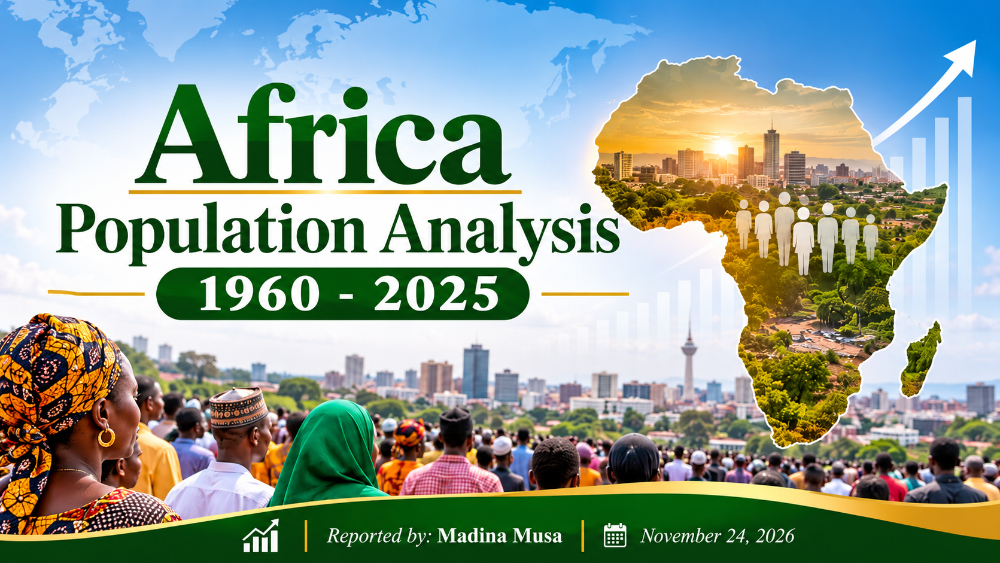
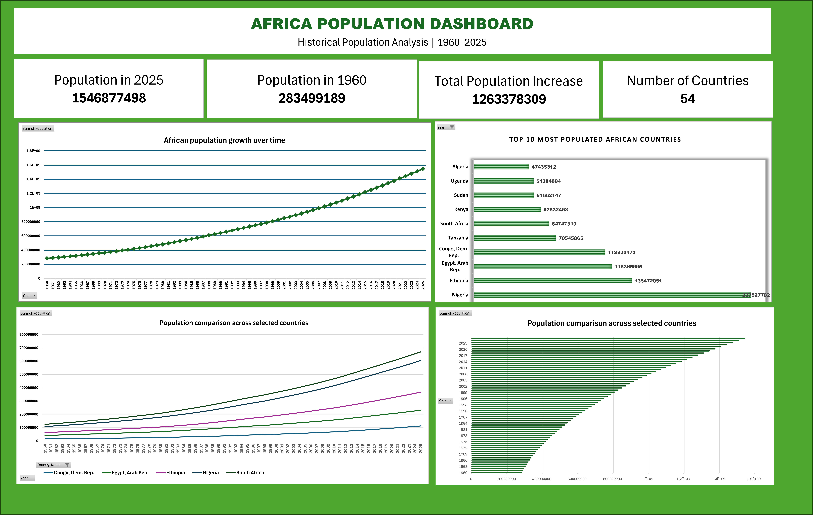

# AFRICA POPULATION ANALYSIS (1960–2025)

### Project Report
- Prepared by: Madina Musa
- Project: Africa Population Analysis
- Period Covered: 1960–2025
- Geographical Coverage: 54 African countries
- Tool Used: Microsoft Excel
- Data Source Recorded in Workbook: World Development Indicators (WDI)
- Data Update Date Recorded: 11 November 2026
- Report Date: 24 November 2026

## 1. Executive Summary
This project examines population trends across 54 African countries between 1960 and 2025. The analysis explores historical population changes, overall continental growth, country-level population comparisons and the distribution of population across African countries.
Microsoft Excel was used to organize and prepare the dataset, calculate population growth indicators, summarize country-level statistics and develop an interactive dashboard.
The analysis recorded a total African population of 283,499,189 in 1960, compared with 1,546,877,498 in 2025.
This represents an increase of 1,263,378,309 people over the 65-year period.

## 2. Project Objectives
The objectives of this project were to:
1.	Examine Africa's historical population growth from 1960 to 2025.
2.	Calculate and compare population figures across the selected years.
3.	Identify the most populated African countries in 2025.
4.	Compare population trends across selected African countries.
5.	Calculate population changes and growth rates.
6.	Present the findings through an interactive Excel dashboard.
	
## 3. Dataset Description
The dataset contains annual population records for 54 African countries, covering 66 years, from 1960 through 2025.
The main analytical dataset contains 3,564 records.
The primary variables include:
Column	Description
Country Name	Name of the African country
Country Code	Three-letter country identifier
Year	Reporting year
Population	Recorded population
Annual Change	Difference from the previous year's population
Growth Rate (%)	Annual population growth rate, stored as a decimal
The first year has no previous-year comparison, so annual change and growth rate are blank for 1960.

## 4. Key Performance Indicators (KPIs)
Indicator	Result
- African population in 1960	283,499,189
- African population in 2025	1,546,877,498
- Total population increase	1,263,378,309
- Number of countries	54

## 5. Major Findings
### 5.1 Continental Population Growth
The dataset demonstrates a substantial increase in Africa's population between 1960 and 2025.
The population increased from approximately 283.5 million to 1.55 billion over the period.
This indicates a major long-term demographic expansion across the continent.
### 5.2 Top 10 Most Populated African Countries in 2025
Rank	Country	Population
- 1	Nigeria	237,527,782
- 2	Ethiopia	135,472,051
- 3	Egypt	118,365,995
- 4	DR Congo	112,832,473
- 5	Tanzania	70,545,865
- 6	South Africa	64,747,319
- 7	Kenya	57,532,493
- 8	Sudan	51,662,147
- 9	Uganda	51,384,894
- 10	Algeria	47,435,312

  [Click here to explore my Africa Population Analysis (1960–2025)](Africa_Population_Analysis_1960_2025.xlsx.xlsx)
#### Nigeria recorded the highest population among the 54 countries in the 2025 dataset.
### 5.3 Country-Level Comparisons
The project compared historical population trends across five selected countries:
•	Nigeria
•	Ethiopia
•	Egypt
•	DR Congo
•	South Africa
The comparison illustrates how population sizes have changed differently across these countries over time.
### 5.4 Population Growth Rates
The dataset also contains annual population growth rates, making it possible to examine the rate of demographic change in individual countries.
These rates are stored as decimal values in the workbook. For example, 0.0133 represents approximately 1.33%.

## 6. Excel Dashboard and Visualizations
The project dashboard presents the analysis through four main visual sections:
1.	Population Growth Over Time: A line chart showing Africa's total population trend from 1960 to 2025.
2.	Top 10 Most Populated Countries: A horizontal bar chart comparing the ten most populated countries in 2025.
3.	Selected Country Comparison: A line chart comparing the historical population trends of five selected countries.
4.	Annual Population Comparison: A horizontal bar chart showing population totals across the years.
The dashboard also contains four KPI cards summarizing the major findings.

## 7. Conclusion
The Africa Population Analysis project provides a historical overview of population changes across 54 African countries between 1960 and 2025.
The findings show substantial population expansion over the period, with Nigeria recording the highest population in the 2025 dataset.
The project demonstrates the use of Microsoft Excel for data organization, calculations, analytical summaries and dashboard development.
It also establishes a foundation for further analysis using SQL and Power BI.

## 8. Limitations and Further Analysis
This project focuses on population figures and calculated population changes. It does not independently investigate the causes of population growth, migration patterns, fertility rates, mortality rates or population projections.
Further analysis using additional demographic indicators could provide deeper insight into the factors influencing population changes across Africa.

## 9. Next Stage
The next stage of this project will use SQL to query, validate, aggregate and analyze the same population dataset.
This will demonstrate the ability to work with structured databases and perform analytical queries beyond spreadsheet-based analysis.

#### Prepared by: Madina Musa
#### Project Title: Africa Population Analysis (1960–2025)

